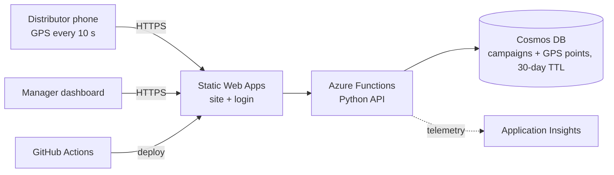

# FlyerTrack Lite — Azure Solutions Architect Portfolio Project

A smart flyer-distribution and GPS-tracking platform: managers define a delivery zone, distributors walk it with a phone, and the app shows **how much of the zone was actually covered**.

**Live demo:** _add your GitHub Pages URL here_  ·  **Cost:** A$0 (GitHub Pages, no Azure account or credit card needed)

## What's in this project
| Part | What it is | Tech |
|---|---|---|
| `docs/` | Working demo website (served by GitHub Pages) | HTML, CSS, JavaScript, Leaflet + OpenStreetMap |
| `tools/` | Generates the sample walk data | Python (standard library only) |
| `architecture/` | The Azure architecture design, decisions, security, cost | Markdown + Mermaid diagrams |
| `terraform/` | The Azure design written as code (**never deployed**, so it costs nothing) | Terraform |

The demo runs entirely in your browser and keeps data in `localStorage`. The Azure design in `architecture/` is how the same product would be built for a real client. Showing both is the point of an architect portfolio: you can design, justify and cost a solution without paying to run it.

## Target Azure architecture (design)

Full details: [architecture/01-target-architecture.md](architecture/01-target-architecture.md)

## Run it
Follow [architecture/00-step-by-step-guide.md](architecture/00-step-by-step-guide.md). You will have it live on the internet in about 30 minutes.

## Limitations (honest scope)
The demo has no server, no login and no shared data: it is a single-browser prototype. The Azure design describes how those gaps are closed ([roadmap section](architecture/01-target-architecture.md#roadmap)).

## License
MIT
