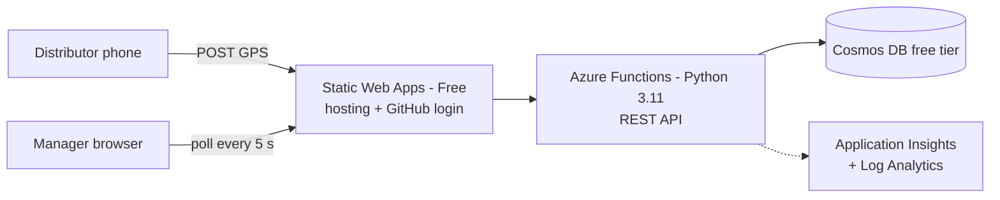

# Target Azure architecture

## 1. Requirements
**Functional:** define campaigns with polygon zones; distributors share GPS from a phone; managers see live positions; report coverage % per zone.

**Non-functional (targets)**
| Area | Target |
|---|---|
| Cost | ≈ A$0 on free tiers at demo scale |
| Scale | ~10 distributors, 1 GPS point / 10 s → ~86k points/day |
| Latency | New position visible in ~5–15 s |
| Security | Authenticated only, TLS, no secrets in Git |
| Privacy | GPS data auto-deleted after 30 days |
| Availability | Best effort, single region (production target in roadmap) |

## 2. Components

| Component | Why |
|---|---|
| Static Web Apps (Free) | Global CDN, TLS and built-in login with no servers to manage |
| Azure Functions (Python 3.11) | Serverless API, pay-per-use, free at this scale |
| Cosmos DB (free tier) | 1000 RU/s + 25 GB free, TTL for retention, partition by campaign |
| Application Insights | Failures and performance visible; daily log cap protects the free allowance |
| Terraform | The environment is reproducible and disposable |

## 3. Data model
`campaigns` (partition key `/id`): `{ id, name, zones:[{name, ring:[[lng,lat],…]}], createdBy, createdAt }`
`locations` (partition key `/campaignId`, TTL on): `{ id, campaignId, distributorId, lat, lng, accuracy, ts, ttl: 2592000 }`
All hot queries filter on `campaignId`, so reads stay in one partition (cheap). Only `campaignId`, `ts` and `accuracy` are indexed to reduce write cost.

## 4. API
| Method | Route | Purpose |
|---|---|---|
| GET/POST | `/api/campaigns` | List / create campaigns |
| POST | `/api/campaigns/{id}/locations` | Submit one GPS point (identity from the platform header, never the body; server stamps the time) |
| GET | `/api/campaigns/{id}/live` | Latest position and trail per distributor |
| GET | `/api/campaigns/{id}/coverage` | Coverage % per zone |

## 5. Coverage algorithm (implemented in the demo)
Sample the zone on a ~20 m grid. A cell is covered when a GPS point (accuracy ≤ 50 m) lies within 25 m of its centre. Coverage % = covered cells ÷ cells inside the polygon. Simple, testable, explainable; O(cells × points), so production pre-aggregates it.

## 6. Decisions (ADR summary)
| # | Decision | Alternatives | Why |
|---|---|---|---|
| 1 | Serverless PaaS (Static Web Apps + Functions) | App Service, AKS/Container Apps | Free, minimal ops; AKS is over-engineered here |
| 2 | Cosmos DB NoSQL | Azure SQL, Table Storage | Native TTL for retention, free grant, single-partition reads |
| 3 | Poll every 5 s | SignalR push | Fewer moving parts; GPS arrives every 10 s anyway |
| 4 | Terraform | Bicep, portal clicks | Reviewable in Git, `plan` previews changes, portable skill |
| 5 | Secrets in app settings (demo) | Managed identity + Key Vault | Static Web Apps managed functions can't use managed identity; upgrade path below |
| 6 | Prototype on GitHub Pages | Deploy Azure for real | Zero cost, no card; design proven without running costs |

## 7. Well-Architected review
| Pillar | In the design | Gap → next step |
|---|---|---|
| Cost | Free SKUs, shared 400 RU/s, minimal indexing, TTL, log cap, 10 s throttle | Autoscale/serverless Cosmos past the free grant |
| Security | Platform login, identity from trusted header, input validation, TTL on personal data | Managed identity + Key Vault, per-campaign roles, private networking |
| Reliability | Managed PaaS, stateless API, code-defined infra | Multi-region + Front Door; offline queue on the phone |
| Operational excellence | Terraform, CI, App Insights, ADRs | Staging environment, alerts, integration tests |
| Performance | Single-partition queries, bounded results | SignalR, pre-aggregated coverage, Cosmos geospatial indexes |

## 8. Security and privacy
- **Spoofing:** identity comes from Static Web Apps, never from the request body. **Tampering:** server-side timestamps, range validation, accuracy filter. **Information disclosure:** auth on every route, TLS, 30-day TTL. **Denial of service/cost abuse:** bounded queries, log cap, rate-limit later via API Management.
- **Known gaps (say these in interviews):** any signed-in user could see any campaign (no roles yet); Cosmos connection string in app settings; Terraform state holds secrets (git-ignored; use remote state in production); public network access.
- Location is personal data: explicit consent (browser permission), minimal fields, automatic deletion. Add a privacy notice and review local law (e.g. Australian Privacy Act) before real use. This is not legal advice.

## 9. Cost
Free allowances change, so confirm in the [Azure Pricing Calculator](https://azure.microsoft.com/pricing/calculator/) and screenshot your estimate. At demo scale every service in the design has a free tier or free grant. At production scale expect paid Cosmos throughput, a paid Static Web Apps or Functions plan, SignalR, Front Door and Key Vault: add them to the calculator and record the total.

## Roadmap
1. Build the Azure version from the Terraform in `terraform/` (needs an Azure account).
2. Entra ID sign-in, roles (Manager/Distributor), managed identity, Key Vault.
3. SignalR push, pre-aggregated coverage, geospatial queries, autoscale.
4. PWA offline queue, multi-region, alerts and runbooks.
